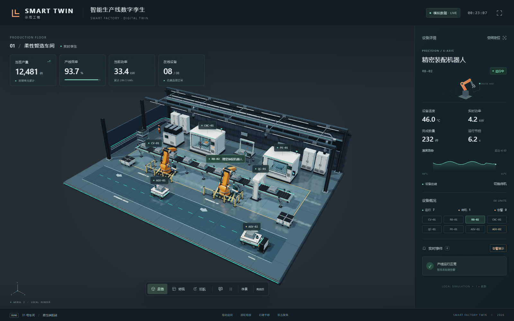
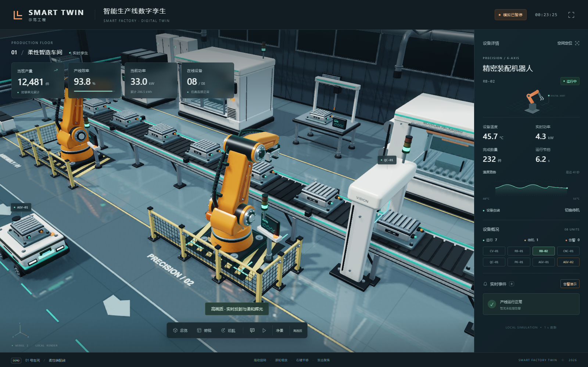
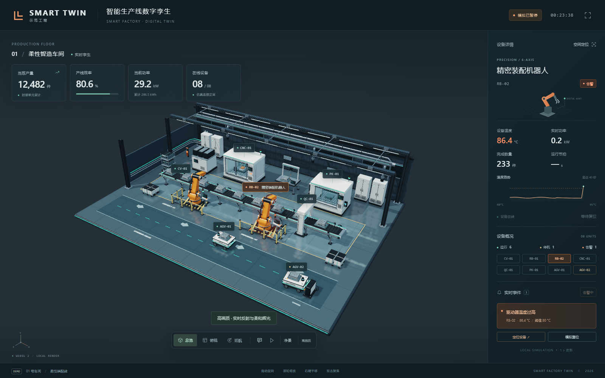
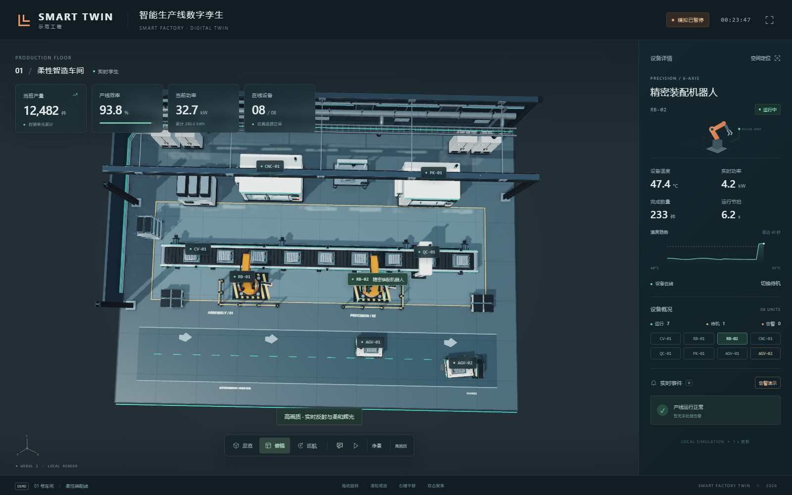
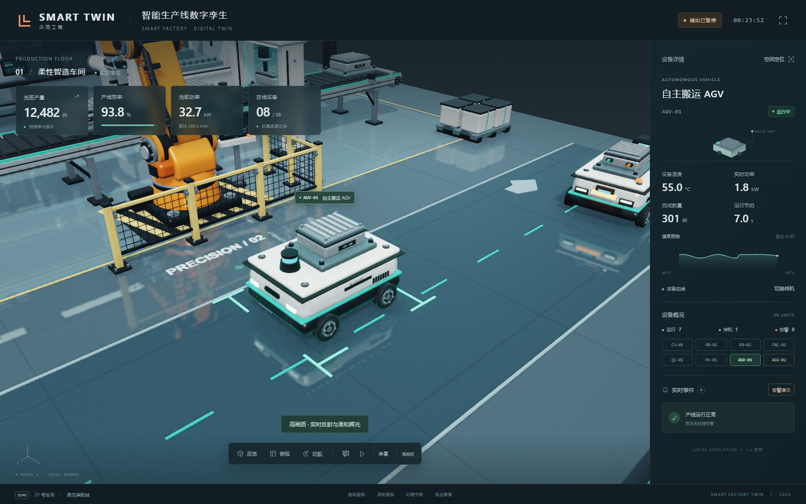

# 智能生产线数字孪生系统 | Smart Factory Twin

基于纯原生 WebGL 2 的零依赖自包含 3D 智能车间与柔性制造产线数字孪生系统。


## 作品截图

<table>
  <tr>
    <td width="50%"><br><sub>车间全景：01 号柔性装配线全场景与宏观生产看板</sub></td>
    <td width="50%"><br><sub>工业机械臂：圆角铸造外壳、减速器轴盖与末端夹爪特写</sub></td>
  </tr>
  <tr>
    <td width="50%"><br><sub>空间告警定位：三维空间红光标定、温升异常与工单联动</sub></td>
    <td width="50%"><br><sub>全景告警联动：空间标签高亮、状态同步与告警复位</sub></td>
  </tr>
  <tr>
    <td width="50%"><br><sub>平面拓扑俯瞰：工位排布、AGV 运行闭环与物料动线</sub></td>
    <td width="50%"><br><sub>物流自动化：闭环巡航 AGV、激光雷达与低位充电桩</sub></td>
  </tr>
</table>

## 作品定位与核心机制

- **商业级柔性智造车间数字孪生**：以高度现代化的 01 号柔性装配车间为空间载体，纳管 8 类核心工业设备节点（输送线、精密装配机械臂、CNC 加工中心、检测工位、自动封装机、巡航 AGV）。
- **6 轴机器人逆运动学仿真（IK）**：两连杆目标空间解析求解，实时约束末端工具垂直朝下，支持装配节拍推演、高度标定与轨迹平滑插值。
- **连续闭环 AGV 调度动力学**：自主移动机器人（AMR/AGV）沿双半圆连贯闭环路径巡航，具备轮组差速自转、雷达避障、低矮触点式充电座对接与空闲低功耗休眠特性。
- **确定性时序遥测模拟引擎**：底层维护固定种子的纯函数数据模型，实时动态积分当班产量、功率能耗时序、设备温升曲线，支持单机模拟设备离线/上线、故障注入与一键应急复位。
- **极端轻量与零依赖交付**：完整离线单文件仅 **126.8 KB**，无需安装任何 npm 依赖，无需网络 CDN 与外部 3D 模型下载，双击即跑。

## 底层自研：纯原生 WebGL 2 架构与渲染管线

本项目完全放弃使用 Three.js、Babylon.js 等通用重型引擎，所有图形算法、变换矩阵与渲染管线均基于 **WebGL 2 原生上下文**纯手写实现：

### 1. 手写工业级高精光影管线 (`src/engine.js`)
- **屏幕空间环境光遮蔽（SSAO）**：手写 GLSL SSAO 着色器，利用线性深度重建法线并执行半球采样，极大强化机械构件之间的接触阴影与机械体量感。
- **2048² 高精深度阴影贴图（Shadow Map）**：支持动态投射主光源方向阴影，配合接触面局部压暗算法，实现真实的车间阴影过渡。
- **平面镜面反射与动态辉光（Bloom）**：在环氧地坪材质上实时计算视线反射与折射混合，对设备工作状态指示灯、安全警示线叠加柔和光晕辉光。
- **自适应性能预算切换**：支持「高画质」（开启 SSAO、反射、辉光与最高 4× MSAA）与「流畅模式」（降低分辨率、精简着色器通道）热切换。

### 2. 参数化程序化工业建模 (`src/factory.js`)
- **零外部 3D 模型下载**：无 `.gltf` / `.obj` 资产包，车间钢架梁系、工业护栏、强电排风管廊、精密机床与工业构件全部由代码几何图元实时程序化生成。
- **圆角倒角与复合网格流（Beveled Geometry）**：生成包含精密外倒角、紧凑法向量与单元贴图坐标的交错顶点缓冲区，单次提交 GPU 高效批处理绘制。
- **视锥自适应剖切（Camera Cutaway）**：当旋转相机至车间后方视角时，近侧建筑墙体与立柱自动淡出隐藏，彻底消除视线阻挡；视角归位后即刻平滑恢复。

### 3. 高性能空间交互与状态机 (`src/app.js` / `src/telemetry.js`)
- **GPU 离屏颜色编码拾取（GPU Picking）**：独立 FBO 渲染无抗锯齿设备 ID 缓冲区，鼠标点击像素级直达设备对象，免除 CPU 昂贵射线求交开销。
- **多端响应式与净景模式**：原生适配键鼠、触摸屏双指手势与移动端窄屏；提供「净景展示（快捷键 `C`）」模式，一键隐去全部 UI 边栏，纯享三维场景。

## 工程能力迁移与应用场景

本项目所展示的纯手写原生 WebGL 2 技术与高拟真产线状态机可直接迁移至以下工业级场景：
- **SCADA / MES 数字化车间产线大屏**：将纯代码轻量 3D 渲染与设备遥测映射迁移至大型工业中控室、产线看板，满足低配大屏主机的高帧率稳定运行。
- **工业机器人离线编程与干涉验证**：将机械臂逆向运动学与三维轨迹推演迁移至工装夹具干涉体检、装配动作预演与产线节拍优化。
- **涉密物理隔离环境的工业数字底座**：针对严格断网、禁用外部网络 CDN、无独显图形工作站的边缘工控终端，提供 126 KB 零依赖、开箱即用的纯前端 3D 可视化解决方案。

## 快速运行与操作指南

### 1. 直接运行（零安装）
双击打开根目录下的 `factory-twin-offline.html`（Windows 用户亦可直接运行 `start.bat`），使用桌面 Chrome、Edge 或现代浏览器直接体验，无需安装任何环境。

### 2. 本地开发与重新构建
```bash
# 启动本地开发服务（端口 4173，修改 src/ 后刷新即看）
npm start

# 重新构建生成自包含离线单文件
npm run build
```

### 3. 操作快捷键总表

| 操作 | 功能说明 |
| --- | --- |
| **鼠标左键拖拽 / 单指滑动** | 空间 360° 环绕观察 |
| **滚轮 / 双指捏合** | 视距无极缩放 |
| **鼠标右键拖拽 / WASD** | 场景平移 |
| **点击设备模型 / 3D 空间标签** | 选择目标设备，右侧呼出详情与趋势 |
| **双击模型 / 按键 F** | 镜头平滑飞渡、空间特写聚焦 |
| **按键 Esc / 总览按钮** | 恢复默认鸟瞰全局视角 |
| **按键 C / 净景按钮** | 隐藏全部业务面板，进入纯净观景模式 |
| **按键 G / 标注按钮** | 切换 3D 空间设备漂浮标签显示 |
| **空格键 / 暂停按钮** | 暂停/恢复本地时序遥测模拟（不影响镜头操作） |
| **画质切换** | 高画质（SSAO + 反射 + 辉光）/ 流畅模式 自由切换 |
| **告警演示 → 定位 → 模拟复位** | 体验完整的温升告警、红光染色、工单联动与恢复闭环 |

## 自动化测试与质量保障

项目内置高密度的算法单元测试与端到端真实浏览器真机验收：

```bash
# 1. 运行 35 项 Node.js 核心单元测试（无须任何外部安装，毫秒级通过）
npm test

# 2. 运行 29 项 Playwright 浏览器真机端到端交互与自动化验收
python tests/browser_acceptance.py --memory
```

- **35 项算法单测覆盖**：机械臂垂直度与包络高度边界、AGV 连续闭环平滑性、法线矩阵逆转置垂直度、遥测时间步进确定性、告警状态机幂等性与恢复闭环。
- **29 项真机验收覆盖**：GPU 拾取精度测试、轨道相机阻尼测试、移动端 390×844 无溢出适配、网络零外部请求断言、GLSL 无报错断言。

## 版权与许可

本项目代码与原创设计保留全部权利。遵循 [MIT License](LICENSE) 开源许可。
