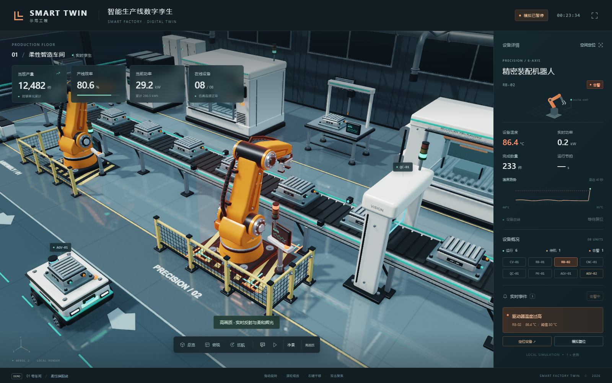
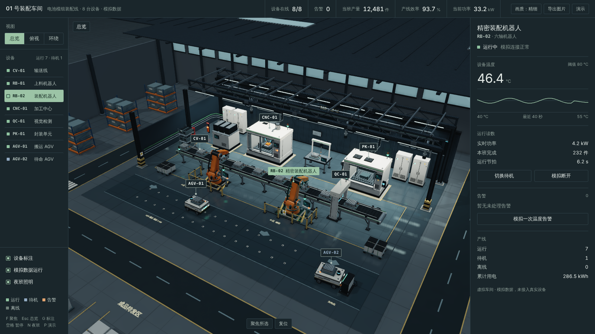
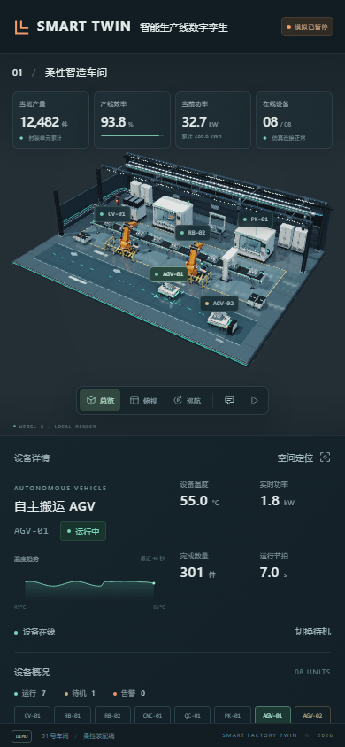

# Factory Twin · 装配车间三维交互原型

原生 WebGL 2 实现的虚拟装配车间，用模拟数据演示设备状态查看、机械臂和 AGV 运动、温度趋势与告警定位。界面按桌面工程软件布局：顶栏读数、左侧视图与设备列表、右侧设备检查器，三维画面占中间区域。


## 场景与交互

- 程序化车间：辊道输送线、两台六轴机器人、立式加工中心、视觉检测工位、封装单元和两台 AGV，外围有钢柱、立柱防撞护角、设备混凝土基础、顶部桥架与下引桥架、AGV 二维码地标、围栏警示牌、消火栓箱等厂房构造。
- 细部：机器人 J1/J2/J3 伺服电机（散热环、制动端盖、插头），输送线导向杆与支架、调平脚和地脚螺栓，加工中心顶部油雾收集器与吊环，封装单元顶部风机过滤单元，货架立柱冲孔与框架斜撑，屋面桁架与檩条。
- 点击设备或左侧列表查看读数，双击或 F 聚焦；总览、俯视、环绕三种视图。
- 模拟温度告警、定位告警设备、模拟复位；切换待机、模拟断开连接。
- 夜班照明、精细 / 流畅画质、导出当前画面 PNG、演示模式（只显示模型）。

这些内容用于图形和交互验证，不构成真实机器人编程、避障或机械干涉检测系统。

| 机械臂近景 | 告警定位 |
|---|---|
|  |  |

| 夜班照明 | 手机布局 |
|---|---|
|  |  |

## 运行

直接双击 `index.html`（或运行 `start.bat`）即可打开，脚本用普通 `<script defer>` 加载，`file://` 下也能运行。不需要 npm、网络 CDN 或外部模型。

也可以起一个本地服务：

```powershell
npm start                      # 端口 4173
python -m http.server 8102     # 任意静态服务均可
```

操作：按住左键旋转、滚轮缩放、右键或 WASD 平移；Esc 回总览，F 聚焦所选，G 设备标注，空格暂停模拟数据，N 夜班照明，P 演示模式。

## 工程结构

```
index.html        页面骨架
css/app.css       界面样式（日间 / 夜班两套颜色变量）
js/engine.js      WebGL 2 渲染：PCF 软阴影、地面反射、环境遮蔽、表面材质噪声、夜班灯光、辉光、MSAA/FXAA、拾取
js/factory.js     车间几何与设备动画
js/telemetry.js   模拟工况（固定随机种子）
js/app.js         交互与面板
assets/           图标
```

部署时复制 `index.html`、`css/`、`js/`、`assets/` 四项即可，合计约 139 KB（2026-11-24），可以放在任意子路径下。目标设备上的流畅度需要实际测量，不从文件体积推断。

## 测试

```powershell
npm test                                     # 几何、运动学、模拟工况单元测试
python tests/browser_acceptance.py --memory  # 用 file:// 打开 index.html 做浏览器验收
python tests/browser_acceptance.py --url http://localhost:4173
```

2026-09-28 在本机运行：`npm test` 35 项通过；浏览器验收 29 项通过（Playwright 自带 Chromium，file:// 加载）。浏览器验收会重写 `screenshots/` 和 `docs/browser-test-*.json`。

## 使用边界

这是自研作品，车间、设备和遥测全部为虚拟和模拟，没有接入真实 PLC/MES/SCADA，没有现场控制回执、生产权限或可靠性保证。可用于方案展示、轻量三维交互原型及嵌入可行性验证；实际项目按协议、点表、场景和目标机器另行验收。

需要监测服务与数据接入的参考工程可查看 [park-studio](https://github.com/yinren112/park-studio)。

本项目按 [MIT License](LICENSE) 授权。
